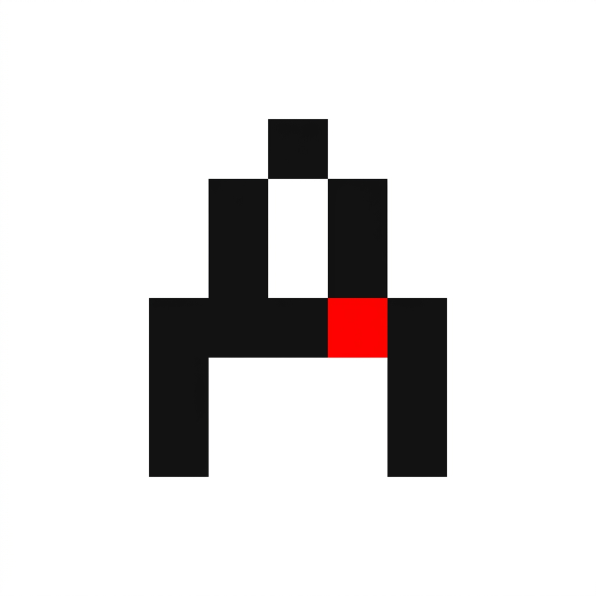

<div align="center">
  

  # Aura Knowledge Engine
  
  **An autonomous AI agent that builds interactive Knowledge Graphs from unstructured text.**

  [](https://opensource.org/licenses/MIT)
  [](https://www.cockroachlabs.com/)
  [](https://aws.amazon.com/)
  [](https://nextjs.org/)
  [](https://fastapi.tiangolo.com/)

</div>

---

## Overview
Aura Knowledge Engine is a full-stack, distributed cloud application that transforms raw, unstructured text into visually interactive 3D Knowledge Graphs. By leveraging state-of-the-art Large Language Models (Llama 3.1 via Groq), Aura dynamically extracts entities and relationships, storing them securely in a highly available CockroachDB Serverless cluster.

The application features a strict **Swiss Brutalist** design system, utilizing absolute geometry, heavy grid lines, and functional typography (`Space Grotesk`, `Bebas Neue`, `DM Mono`) with minimal color accents for a highly precise and raw technical aesthetic.

## The Mechanism
1. **User Input → Next.js Frontend:** The user types unstructured text into the chat interface built with Next.js 15 (App Router). 
2. **Next.js Proxy → FastAPI Backend:** The Next.js API route forwards the request to the FastAPI backend server hosted on AWS EC2.
3. **FastAPI → LangGraph Agent:** FastAPI passes the text to a LangGraph-based agentic pipeline which orchestrates the state and tool calls.
4. **LangGraph → Llama 3.1 (Groq):** The agent sends the user's text to Llama 3.1 hosted on Groq's ultra-fast inference API to extract structured entity and relationship JSON.
5. **Extracted Data → CockroachDB:** Nodes and edges are inserted into a distributed CockroachDB cloud database with duplicate-prevention constraints.
6. **Response → Frontend → 3D Graph:** The frontend fetches the updated graph and renders it via `react-force-graph-3d` as an interactive, physics-simulated 3D network.

## Architecture & File Structure

```text
aura-knowledge-engine/
├── backend/                       # Python FastAPI Server (Hosted on AWS EC2)
│   ├── agent.py                   # LangChain/LangGraph AI extraction logic
│   ├── database.py                # CockroachDB SQLAlchemy connection setup
│   ├── models.py                  # Database schema (Nodes, Edges, pgvector)
│   ├── main.py                    # FastAPI application routes
│   └── requirements.txt           # Python dependencies
├── frontend/                      # Next.js React UI (Hosted on Vercel)
│   ├── public/                    # Assets and Logos (logo_swiss.jpg)
│   ├── src/app/
│   │   ├── api/                   # Next.js Serverless Proxy Routes
│   │   ├── components/
│   │   │   └── Graph.tsx          # 3D Force Graph Component
│   │   ├── engine/                # Engine Chat & Visualization Interface
│   │   ├── page.tsx               # Swiss Brutalist Landing Page
│   │   └── globals.css            # Custom Swiss CSS Variables & Tailwind
│   ├── package.json               # Node.js dependencies
│   └── tailwind.config.ts         # Tailwind CSS v4 configuration
├── .gitignore
└── README.md                      # Project Documentation
```

## Setup & Installation

### Prerequisites
- Python 3.10+
- Node.js 18+
- CockroachDB Serverless URL (`DATABASE_URL`)
- Groq API Key (`GROQ_API_KEY`)

### 1. Backend Setup
```bash
cd backend
python -m venv venv

# Windows
venv\Scripts\activate
# Mac/Linux
source venv/bin/activate

pip install -r requirements.txt
uvicorn main:app --reload
```
Create a `.env` file in the `backend/` directory with your database and API keys.

### 2. Frontend Setup
```bash
cd frontend
npm install
npm run dev
```
Open `http://localhost:3000` to view the application. The frontend automatically proxies requests to the backend server.

## Cloud Deployment
1. **Frontend**: The React UI is optimized for Edge deployment and is continuously deployed via **Vercel**. It uses Serverless API routes to proxy requests, securely avoiding Mixed Content errors.
2. **Backend**: Hosted on an **AWS EC2 Ubuntu Instance**. The FastAPI server runs continuously in the background, with port 8000 exposed via AWS Security Groups.
3. **Database**: Hosted on **CockroachDB Serverless** using robust PostgreSQL bindings.

## License
This project is licensed under the MIT License - see the LICENSE file for details.
